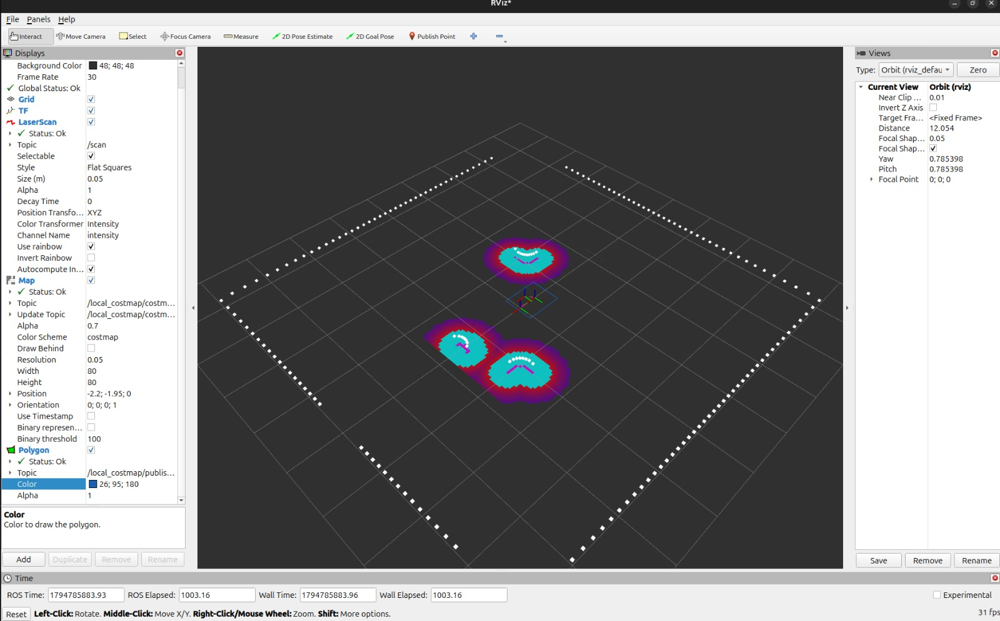

# Navegación y Mapas de Costos 2D (`lira_rover_nav`) — Rover LIRA UNAM

Implementación, modelado analítico y simulación cerrada de los **Mapas de Costos 2D (`nav2_costmap_2d`)** en **ROS 2 Jazzy** para el Rover del Laboratorio de Investigación en Robótica Avanzada (LIRA - FI UNAM).

## 1. Características Principales
* **Arquitectura Dual (`local_costmap` y `global_costmap`):**
  * **Mapa Local:** Ventana deslizante (`rolling_window: true`) de `4m × 4m` a `5 Hz` (`0.05 m/celda`) en el marco `odom`, usando `VoxelLayer` + `InflationLayer`.
  * **Mapa Global:** Cuadrícula de `10m × 10m` a `1 Hz` en el marco `map`, usando `ObstacleLayer` + `InflationLayer`.
* **Geometría Física del Chasis (`footprint`):** Polígono rectangular parametrizado de `0.70 m × 0.60 m` (`padding: 0.03 m`), generando un radio inscrito crítico $r_{\text{in}} = 0.33\text{ m}$ (costo `253`), radio circunscrito $r_{\text{circ}} \approx 0.503\text{ m}$ e inflación exponencial ($\alpha = 3.0\text{ m}^{-1}$, $R_{\text{inf}} = 0.65\text{ m}$).
* **Simulador Cinemático y LiDAR Integrado (`sim_rover_node.py`):** Integra odometría en $SE(2)$ (Runge-Kutta 2.º orden), publica `/odom` y el árbol `TF2` (`map → odom → base_link → laser_frame`) y genera un `/scan` virtual de 180 rayos para pruebas sin hardware físico.
* **Preparado para Hardware Real (Bus CAN) y Webots:** Desacoplado mediante tópicos estándar (`/odom`, `/scan`, `/cmd_vel`) para integrarse directamente con el controlador del modelo en Webots o con la odometría del bus CAN de los 8 motores a 48 V.

## 2. Documentación Técnica Incluida
* [Reporte Técnico y Manual de Implementación del Mapa de Costos (PDF)](docs/MAPADECOSTOS_ROVER_LIRA.pdf)
* [Fundamentos Matemáticos de Planificación de Movimiento — Cap. 7 Springer Handbook (PDF)](docs/PLANIFICACION_MOVIMIENTO_CAP7.pdf)
* [Diagrama Eléctrico de Potencia 48 V y Bus CAN de 8 Motores (PDF)](docs/Diagrama_Conexiones_CAN.pdf)

## 3. Estructura del Paquete
~~~text
lira_rover_nav/
├── config/
│   ├── lira_costmap_params.yaml   # Parámetros de capas, footprint e inflación
│   └── lira_costmap.rviz          # Configuración precargada de RViz2
├── docs/                          # Reportes técnicos, diagrama CAN y capturas
├── launch/
│   └── sim_costmap.launch.py      # Lanzador integral (TF2 + Sim + Costmaps + Lifecycle + RViz2)
└── lira_rover_nav/
    └── sim_rover_node.py          # Nodo simulador cinemático y LiDAR virtual
~~~

## 4. Requisitos e Instalación (Ubuntu 24.04 / ROS 2 Jazzy)
~~~bash
sudo apt update
sudo apt install -y ros-$ROS_DISTRO-nav2-costmap-2d \
                    ros-$ROS_DISTRO-nav2-lifecycle-manager \
                    ros-$ROS_DISTRO-tf2-ros \
                    ros-$ROS_DISTRO-teleop-twist-keyboard \
                    ros-$ROS_DISTRO-rviz2
~~~

## 5. Compilación y Ejecución
Desde la raíz de `ros2_ws`:
~~~bash
colcon build --symlink-install --packages-select lira_rover_nav
source install/setup.bash
~~~

* **Terminal 1 (Levanta TF2, simulador, Mapas de Costos y RViz2):**
~~~bash
ros2 launch lira_rover_nav sim_costmap.launch.py
~~~
* **Terminal 2 (Teleoperar el rover con `i`, `j`, `l`, `k` para ver deslizarse el Costmap):**
~~~bash
ros2 run teleop_twist_keyboard teleop_twist_keyboard
~~~

## 6. Integración con Webots o Hardware Real
Para conectar el mapa de costos al simulador en Webots o al rover físico sin modificar `lira_costmap_params.yaml`:
1. Asegurar que el controlador del rover publique `/odom`, la transformación `odom → base_link` y `/scan` (o `/camera/depth/color/points`).
2. Desactivar el nodo simulador interno (`sim_rover_node`) en `sim_costmap.launch.py` y ajustar las coordenadas físicas `[x, y, z]` del sensor en `static_tf_base_to_laser`.

---
*Desarrollado por Luis Maximiliano Guzmán Ortiz — Servicio Social LIRA, Facultad de Ingeniería, UNAM.*
